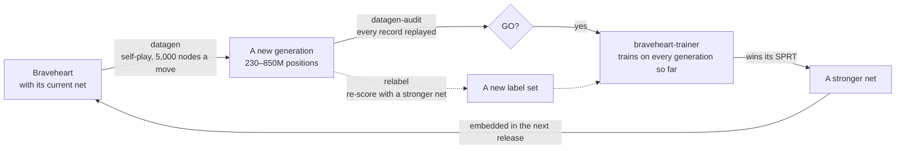

<p align="center">
  <picture>
    <source media="(prefers-color-scheme: dark)" srcset="https://raw.githubusercontent.com/Braveheart-Chess/braveheart-branding/main/banner-dark.png">
    
  </picture><br>
  <sub>Logo © the artist, used under licence. All rights reserved; not covered by this repository's licence (<a href="https://github.com/Braveheart-Chess/braveheart-branding#licence">details</a>).</sub>
</p>

# braveheart-selfplay

**3.2 billion chess positions, played and labelled by a chess engine against
itself, and audited down to the last record.**

[Braveheart](https://github.com/Braveheart-Chess/braveheart) learned chess
from its own games. This repository holds the self-play dataset that taught
it, and the pipeline that grows it: `datagen` plays the engine against itself,
`relabel` re-scores old positions with a stronger net, and the audits replay
every record before anything trains on it. Every NNUE net Braveheart has
shipped was trained on this data.

<div align="center">

| 3.2 billion | 34.2 million | 7 | 2.35 billion | 0 | 13,824 of 13,824 |
|:-:|:-:|:-:|:-:|:-:|:-:|
| positions | games | generations | records relabelled | records failing the audit | games regenerated from their seeds |

</div>

## A chess engine that taught itself

Generation 0 was played by PeSTO, a hand-written evaluation with no learning
in it. Net 1 was trained on those games and played generation 1. Every
generation since has been played by the engine's default net of its day,
trained on all the generations before it, so each generation comes from a
stronger player than the last.



| Gen | Played by | Positions | Games | Draws | Full audit |
|--:|:--|--:|--:|--:|:--|
| 0 | PeSTO, hand-written | 231,240,344 | 2,387,961 | 34.5% | GO |
| 1 | net 1 | 368,354,466 | 3,703,015 | 44.7% | GO |
| 2 | net2x80 | 307,037,810 | 3,265,807 | 43.0% | GO, 2,304 of 2,304 games regenerated |
| 3 | net4w512 | 628,213,254 | 6,562,925 | 46.4% | GO, 2,304 of 2,304 games regenerated |
| 4 | net 5 | 495,147,759 | 5,252,191 | 47.2% | GO, 3,072 of 3,072 games regenerated |
| 5 | net6k4 | 318,934,530 | 3,409,848 | 47.7% | GO, 2,304 of 2,304 games regenerated |
| 6 | net7rl012 | 849,868,621 | 9,662,116 | 47.5% | GO, 3,840 of 3,840 games regenerated |
| **All** | | **3,198,796,784** | **34,243,863** | | |

Generation 7 is next, to be played by net8x160, the engine's default net since
`v0.51.0`. Every run behind these numbers, including the smoke tests and the
failures, is in the ledger, [docs/datasets.md](docs/datasets.md).

## What the data bought the engine

| Milestone | Result |
|:--|:--|
| Net 1, trained on generation 0 alone, against the PeSTO engine that played it | **+587 ± 83 Elo** in self-play; about +275 to +375 against Stockfish |
| Net 2: net 1's recipe with generation 1 added, nothing else changed | **+113 ± 21 Elo**, from data alone |
| net7rl012: generations 0–2 re-scored by net7, the positions unchanged | **+16.3 ± 7.7 Elo**, more than adding generation 5 had given (+6.8 ± 4.5) |
| net8: generation 6 added | **+14.1 ± 6.9 Elo** |
| The rating ladder against Stockfish 19 | **2602 ± 47** for the last PeSTO release, **2977 ± 32** with net 1, **3220 ± 35** with net8x160 (`v0.51.0`) |

The net 2, net7rl012 and net8 rows each compare two nets that differ only in
their data or its labels, so they isolate what the data is worth. The ladder
also counts the search work done over the same months. Every result is in
braveheart-trainer's
[nets.md](https://github.com/Braveheart-Chess/braveheart-trainer/blob/main/docs/nets.md).

## Fun facts from the ledger

- **Not one bad record.** The audit rebuilds every record by replaying its
  game from the start and compares the two byte for byte. All 3.2 billion
  records have been through it: 0 failures, in every generation.
- **The same seed makes the same games, on any machine.** The audits
  regenerated 13,824 of 13,824 sampled games identically from their seeds. As a
  negative control, the same seeds with a different net, or at half the nodes,
  matched 0 of 48. Relabelled shards re-run on an Apple arm64 Mac matched the
  x86-64 cloud runs byte for byte, 66 of 66. The AVX-512 and AVX2 builds play
  identical games too: the evaluation is exact integer arithmetic.
- **The stronger it plays, the more it draws.** Draws rose from 34.5% under
  PeSTO to 47.5% in generation 6, and games got shorter, from a median of 114
  plies in generation 1 to 102.
- **White's first-move advantage showed up with skill.** Under PeSTO, white
  and black won about equally often (32.2% and 33.3%). Net 1 was strong enough
  to show white's edge, an 8.3-point gap, which has narrowed in every generation
  since, to 5.3.
- **Up 20 pawns was always a forced mate.** Generation 0 adjudicated a win at
  2,000 centipawns. A search with 400 times the nodes found a forced mate in
  all 200 sampled games, a median of about 3 moves away. The bar dropped to
  1,200: on the same games it would still have called the right winner 99.98%
  of the time, and reversed none.
- **No two openings alike.** In generation 0's audit sample, 18,554 games had
  18,554 different starting positions, and the engine's first move was one of
  839 different moves. The most common, `d2d4`, came in 4.4% of games.
- **A search disagrees with itself.** The same net re-scoring its own games at
  the same budget still changes 91% of the scores, by a median of 17
  centipawns, because a 5,000-node search depends on what its hash and history
  tables already hold. That's the noise floor: only a change beyond it is a new
  net's opinion.
- **Better labels beat more data, once.** Re-scoring generations 0–2 with
  net7 changed no positions, only scores, and gained more strength than a whole
  new generation had. Doing the same to generations 3–5 failed its SPRT: their
  original labellers were already close to the new net. Both results are kept.
- **Spot instances, gladly.** One 64-core `c8a.16xlarge` plays about 18,700
  to 25,200 positions a second, depending on the net, and a whole generation
  costs about $5–20 of compute (estimates). Spot reclaimed 16 of the 20
  instances that relabelled generations 0–2. Each lost only the shards it had
  in progress, and nine runs later the label set was complete and passed its
  audit.
- **About 17 bytes a position.** All 3.2 billion positions, with their full
  game records and manifests, take 55.5 GB of gzip in S3; both label sets add
  29.0 GB. In a trainer's binary format, 32 bytes a record, the positions alone
  are 102 GB.

## Why you can trust it

- **Append-only, forever.** A generation's positions and original labels
  never change. A relabel writes a new label set beside them, and the bucket
  is versioned.
- **Every shard says where it came from:** this repository's commit, the
  engine's version, commit and bench signature, the net's id and SHA-256, every
  setting it was played with, and the SHA-256 of its files.
- **The same seed always makes the same data.** `tests/golden.rs` hashes four
  games from fixed seeds against values computed by the engine's own code. Any
  change to the data fails CI, and a deliberate one is recorded with the
  generation it applies from.
- **Audited before anything trains on it.** A generation needs a full audit
  with a GO verdict, and a label set its own audit.
- **Every run on the record,** including smoke tests and failed, cancelled and
  interrupted runs. Numbers come from the shard manifests, and estimates such
  as costs are labelled as estimates.

## Inside the data

Each position is one line of plain text, the layout `bullet` and most NNUE
trainers read or convert from:

```text
<fen> | <score> | <result>
rnbqk1nr/ppp2pb1/3pp1p1/7p/2P4P/N2P4/PPQ1PPP1/R1B1KBNR w KQkq - 2 6 | -51 | 0.5
```

The score is the engine's own search at 5,000 nodes a move, in centipawns, and
the result is the game's: both from white's point of view. A training target
blends them, `λ × result + (1 − λ) × sigmoid(score / 400)`, with λ 0.5 in
every net shipped so far.

Beside the positions, every game is kept whole (start position, every move,
every score and how it ended), so any generation can be re-scored or
re-filtered without being replayed from scratch. A manifest records how each
shard was made. Positions are kept only when they're quiet: not in check, a
best move that isn't a capture or promotion, and no mate score.

```text
s3://jwall-engineering-braveheart-selfplay-positions/data/selfplay/
  v1/gen=N/run=R/task=T/          the originals, Hive-partitioned
    positions/  games/  manifests/  task.json
  relabel/<label set id>/gen=N/   other label sets, the same layout
```

The bucket is private. braveheart-trainer's GPU tasks read it to train, and
it is shared, read-only, with
[braveheart-databricks](https://github.com/Braveheart-Chess/braveheart-databricks)
for analysis. A training set is a choice of prefixes: all of generation 6 is
`v1/gen=6/`. The formats are specified in full in
[docs/datagen.md](docs/datagen.md).

## Quick start

You need Rust 1.85 or newer. The build fetches the engine at the release
pinned in `Cargo.toml`.

```sh
cargo build --release --locked      # datagen, relabel, datagen-audit
cargo test --locked                 # includes the golden fingerprints
```

**Play a minute of self-play** with the current net. On 8 cores of an Apple M3
Max it makes about 125,000 positions:

```sh
./target/release/datagen --config datagen.toml --out /tmp/pilot \
  --run pilot --task local --threads 8 --max-minutes 1
```

**Audit it.** The audit reads shards gzipped, as they're stored, and ends with
a verdict:

```sh
gzip /tmp/pilot/*.positions.txt /tmp/pilot/*.games.jsonl
./target/release/datagen-audit check /tmp/pilot --bullet   # ... Verdict: GO
```

**Relabel it.** `relabel` reads the stored layout (`manifests/`, `positions/`
and `games/` under each task), so lay the shards out that way first. With the
net that played them, most scores still move a little: that's the noise floor.

```sh
d=/tmp/selfplay/task=local && mkdir -p $d/manifests $d/positions $d/games
for m in /tmp/pilot/*.json; do
  s=$(basename "$m" .json)
  cp "$m" $d/manifests/
  cp /tmp/pilot/$s.positions.txt.gz $d/positions/$s.txt.gz
  cp /tmp/pilot/$s.games.jsonl.gz $d/games/$s.jsonl.gz
done
./target/release/relabel --in /tmp/selfplay --out /tmp/relabelled --net default
```

`datagen.toml` holds every setting the games are played with and the audit's
quality bars, each with the measurement behind it.

## Growing the dataset

New generations and label sets are made in the cloud, on spot instances, by
two GitHub Actions workflows:

```sh
gh workflow run Datagen --ref main -f instances=3 -f minutes=180 -f note="gen 7"
gh workflow run Relabel --ref main -f generations=0,1,2 -f instances=3 -f minutes=280
```

`ci/datagen-manager.py` and `ci/relabel-manager.py` run a whole campaign from
a laptop, relaunching each instance spot reclaims until the target is met.
Then `ci/datagen-full-audit.sh` or `ci/label-set-audit.sh` audits the result,
and the run goes in [docs/datasets.md](docs/datasets.md).
[docs/datagen-runbook.md](docs/datagen-runbook.md) is the full procedure.

> [!NOTE]
> **Until the cutover, don't run either workflow from here.** The positions
> were copied to this repository's bucket on 2026-11-16 and audited, and the
> workflows are ported, but the engine's workflows still write to its own
> bucket until it hands the dataset over. A run in either place would be
> missing from the other. See [AGENTS.md](AGENTS.md#until-the-cutover).

## The repository

| Path | What it is |
|:--|:--|
| `src/datagen.rs`, `src/bin/datagen.rs` | Self-play: games, filters, shards and manifests |
| `src/relabel.rs`, `src/bin/relabel.rs` | Re-scoring stored positions into a new label set |
| `src/bin/datagen_audit.rs` | The generation audit, and the deeper checks behind the settings |
| `src/rng.rs` | The engine's random number generator, copied verbatim |
| `tests/` | The golden fingerprints, provenance, datagen and relabel tests |
| `datagen.toml` | The settings datagen plays with, and the audit's bars |
| `ci/` | The cloud tasks, the campaign managers and the audit scripts |
| `jaws.yaml` | The infrastructure: the task runner's instances and the dataset bucket |

| Document | What it covers |
|:--|:--|
| [docs/datasets.md](docs/datasets.md) | The ledger: every generation, label set, run and audit |
| [docs/datagen.md](docs/datagen.md) | How positions are made, the file formats and the S3 layout |
| [docs/datagen-runbook.md](docs/datagen-runbook.md) | Running a generation and auditing it, with generation 0's findings |
| [docs/relabel.md](docs/relabel.md) | Relabelling: the design, the noise floor and the manager |

## History

This code moved here from the engine repository,
[Braveheart-Chess/braveheart](https://github.com/Braveheart-Chess/braveheart),
at
[`1a25b13`](https://github.com/Braveheart-Chess/braveheart/commit/1a25b1375049c88b2c9cf01d26c90216f5f65d88)
on 2026-11-16, with its history: its part of the engine's `crates/tools/`
became this repository's crate. Pull request numbers in the older commit
messages and in the ledger refer to the engine repository. The engine was
called rusty-chess-v2 through `v0.52.0`, and the data's schema keeps that name
(`rusty-chess-selfplay/1`) so existing data stays readable.

## Contributing

Changes go through pull requests with one-line Conventional Commits; see
[CONTRIBUTING.md](CONTRIBUTING.md). The rules for coding agents, and for
keeping the research record, are in [AGENTS.md](AGENTS.md).

## License

The code is MIT licensed; see [LICENSE](LICENSE). The logo is not part of this
repository and is **not** covered by the MIT licence; see
[braveheart-branding](https://github.com/Braveheart-Chess/braveheart-branding#licence).
